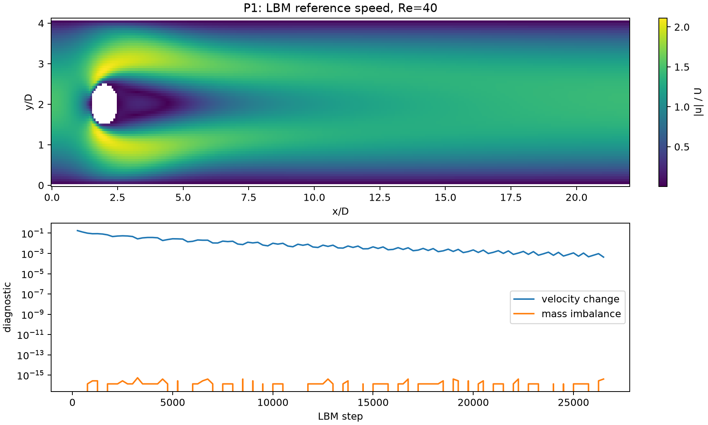
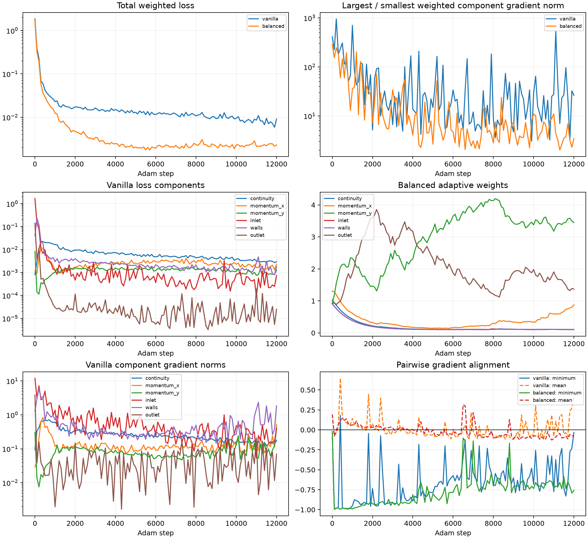
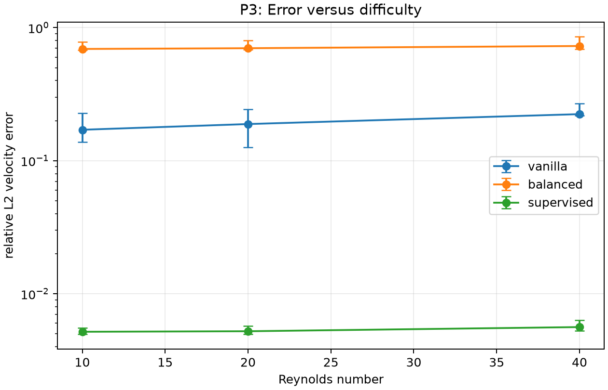
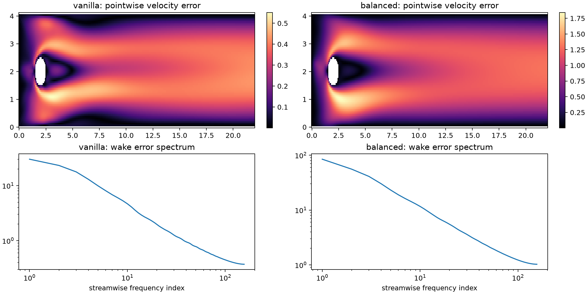
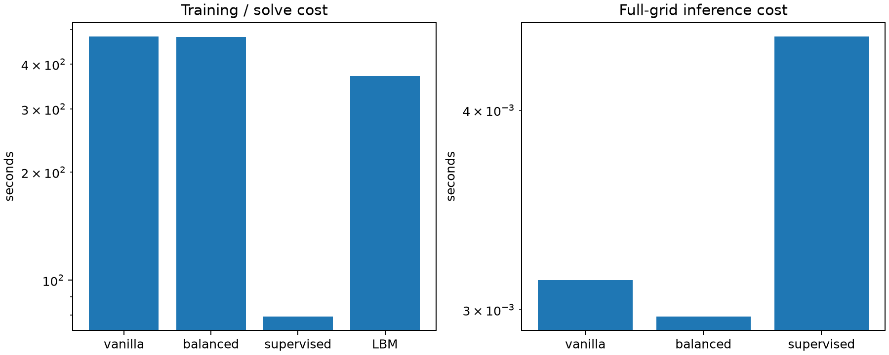

# Project 3: Diagnosing Physics-Informed Neural Network (PINN) Convergence for Cylinder Flow

**Team Optimus Prime**<br>
**Path B: Diagnosis, with an unsuccessful attempted remedy**

## 1. Outreach log

Our team conducted researcher outreach by email, beginning with Dr. Jeonglae Kim. A scheduling conflict led Dr. Kim to recommend Professor Leixin Ma, whom we subsequently interviewed by Zoom. The full outreach sequence, including the decline and non-response, is recorded below.

| Date | Contact and method | Outcome |
|---|---|---|
| October 12, 2026 | Emailed Dr. Jeonglae Kim | Initial outreach |
| October 15, 2026 | Second response from Dr. Kim | He reported a scheduling conflict and recommended contacting Professor Leixin Ma |
| October 16, 2026 | Emailed Professor Leixin Ma and Dr. Pedro Peralta | Dr. Peralta did not respond; Professor Ma responded the same day and confirmed a Zoom appointment |
| October 19, 2026 | Zoom interview with Professor Ma | Discussed computational cost, fluid–structure interaction (FSI), prior PINN limitations, and machine-learning alternatives |
| October 19, 2026 | Contacted Vivian Oletty in Professor Ma's group | Requested additional guidance on a suitable project problem |
| October 20, 2026 | Follow-up interview with Vivian Oletty | Confirmed the problem brief and identified fixed-cylinder flow as the appropriate starting case |
| October 28, 2026 | Follow-up with Professor Ma with results | Sent recommendation memo to Professor Ma; no response as of the project due date |

Professor Ma explained that large-scale finite-element and finite-volume simulations, particularly fluid–structure interaction problems, can require millions of computational nodes and several hours even on supercomputers. She also described PINN convergence and accuracy problems for systems involving multiple PDEs and geometric nonlinearities.

The follow-up interview with Vivian Oletty, which served as confirmation of our problem brief, allowed us to identify fluid flow around a stationary circular cylinder as an appropriate starting point, with a moving cylinder and coupled fluid–structure interactions as potential extensions. He also discussed oscillatory dynamics, long-term prediction accuracy, graph neural networks, frequency-domain techniques, and MeshParamNet, which combines graph learning with fast Fourier transform (FFT)-based representations and finite-element simulation data to predict structural deformation.

### Selected interview questions and answers

| Question | Interview response |
|---|---|
| What computational challenges limit conventional numerical solvers? | Professor Ma explained that large-scale finite-element and finite-volume simulations, especially FSI, can require millions of nodes and several hours even on supercomputers. |
| Have PINNs successfully addressed these computational challenges? | Professor Ma indicated that PINNs have been investigated but often experience convergence and accuracy difficulties for multiple PDEs and geometric nonlinearities. |
| What physical problem would provide a suitable starting point? | Vivian Oletty identified flow around a fixed cylinder, with a moving cylinder as a possible extension. |
| How long might a simulation of the simplified problem take? | Vivian indicated approximately one to two hours, potentially less than one hour depending on the setup. |
| What alternative machine-learning approaches have been explored? | Vivian discussed MeshParamNet, graph neural networks, FFT-based representations, and supervised finite-element data for structural-deformation prediction. |

## 2. Problem brief

### Scientific problem and real-world value

Professor Ma's work uses finite-element and finite-volume solvers on models with millions of nodes. Individual simulations can require hours even on ASU supercomputers. Design optimization makes this cost more consequential because it requires many forward evaluations. She described difficult PINN convergence, limited accuracy for coupled PDE systems, and stronger practical performance from supervised black-box surrogates.

High-fidelity fluid–structure interaction combines Navier–Stokes flow, nonlinear structural dynamics, moving interfaces, and sometimes remeshing or turbulence closures. The governing physics therefore include fluid momentum and incompressibility, structural dynamics, and kinematic and dynamic coupling conditions at the fluid–structure interface. At high Reynolds numbers, turbulence approximations can introduce additional modeled physics.

### Current solver, cost, and specific challenges

Professor Ma reported using finite-element and finite-volume methods for structural, fluid, and coupled fluid–structure problems. The main computational difficulties are multimillion-node meshes, large structural deformation, remeshing, coupled nonlinear PDEs, and repeated forward evaluations during design optimization. Individual simulations can require hours even on ASU supercomputers, making broad design searches or parameter studies expensive. For the simplified cylinder problem, Vivian Oletty estimated approximately one to two hours per conventional simulation, potentially less than one hour depending on the setup.

### Prior PINN, surrogate, and neural-operator experience

The interview notes report that standard loss-based PINNs were difficult to train to convergence and insufficiently accurate for her forward multiphysics applications. Her group therefore uses supervised black-box learning where it is more reliable. Professor Ma's [MeshODENet](https://arxiv.org/abs/2509.18445), developed with Kangzheng Liu, combines graph neural networks with neural ordinary differential equations for repeated structural simulations. It is a supervised, data-driven forward surrogate trained on conventional-solver trajectories, not a PDE-residual PINN.

MeshODENet has been demonstrated on structural mechanics problems, not on the cylinder-flow problem studied here. Therefore, this report treats it as an architectural direction for repeated design evaluations, not as a measured competitor or a demonstrated CFD solution. Vivian Oletty also discussed MeshParamNet, graph neural networks, and frequency-domain representations as related supervised approaches.

### Researcher review status

Vivian Oletty, a researcher in Professor Ma's group, reviewed and confirmed the problem brief during the October 20, 2026 follow-up interview. He identified flow around a stationary circular cylinder as an appropriate starting point and moving-cylinder FSI as a possible extension.

## 3. Minimal case formulation

### Path selection and retained difficulty

We selected **Path B: Diagnosis**, with an unsuccessful attempted remedy. The goal is to reproduce the reported forward-PINN training difficulty, separate representation capacity from physics-informed training behavior, and test whether component-wise gradient-magnitude balancing fixes the problem.

### PDE, domain, boundary conditions, and difficulty knob

The nondimensional channel is

$$
\Omega=[0,22]\times[0,4.1]\setminus
\{(x,y):(x-2)^2+(y-2)^2\le0.5^2\}.
$$

The steady incompressible Navier–Stokes equations are

$$
u_x+v_y=0,
$$

$$
uu_x+vu_y=-p_x+\frac{1}{Re}(u_{xx}+u_{yy}),
$$

$$
uv_x+vv_y=-p_y+\frac{1}{Re}(v_{xx}+v_{yy}).
$$

The inlet conditions are

$$
u(0,y)=\frac{6y(4.1-y)}{4.1^2},\qquad v(0,y)=0,
$$

which give unit mean velocity. The channel walls and cylinder use no-slip conditions. The PINN outlet imposes $p=0$, $u_x=0$, and $v_x=0$. Reynolds number $Re\in\{10,20,40\}$ is the difficulty knob. Because the target PDE is steady, the PINN has no physical time coordinate or initial condition. The lattice-Boltzmann method (LBM) is initialized throughout the fluid with the parabolic velocity profile and unit density, then advanced in pseudo-time to a steady field.

### What was simplified and why the hard part remains

This is not a fluid–structure interaction simulation. It removes structural dynamics, interface motion, remeshing, three-dimensional flow, turbulence, and uncertain constitutive behavior. It retains nonlinear momentum, incompressibility, an immersed no-slip boundary, competing equation and boundary losses, and increasing convective influence. This makes it a controlled precursor, not a basis for directly extrapolating quantitative conclusions to moving-boundary FSI.

## 4. Experiments

The experiment follows the course [P1–P5 diagnostic kit](https://designinformaticslab.github.io/DesignOptimization2025/project3.html#anchor-pinn-diagnostic-kit) and the Path B requirement to reproduce a failure and separate competing explanations with controlled comparisons.

### 4.1 P1 — Conventional reference and validation status

A nine-velocity, two-dimensional (D2Q9) LBM supplies numerical comparison fields. The solver uses Bhatnagar–Gross–Krook (BGK) collision, bounce-back on the walls and stair-step cylinder, a prescribed parabolic inlet, and a developed-flow outlet that copies and rescales the penultimate-column profile to enforce the inlet volume flux. The pressure reconstructed from density is shifted so that mean outlet pressure is zero.

The implemented acceptance checks require four consecutive 250-step velocity-change checks below $10^{-3}$, endpoint volume-flux imbalance below 1%, and a grid-disagreement measure below 5%. At $Re=40$, the 16-versus-24-nodes-per-diameter comparison gives a 1.37% relative velocity difference. This is evidence of resolution consistency between those two grids, not a continuum-error bound.

An independent reference audit reached a more limited conclusion:

- the D2Q9 equilibrium, collision, streaming, and stationary bounce-back operations pass implementation tests;
- the recorded endpoint volume-flux balance is imposed by the outlet and is not an independent mass-conservation check;
- only $u$ enters the stopping rule, so stationarity of $v$, density, pressure, drag, and total mass was not established;
- the saved $x$-coordinate and $y$-coordinate spacings differ by about 0.606%, and stair-step bounce-back does not establish accuracy on the true circular boundary;
- a recomputed $Re=10$ section-volume-flux departure reaches about 1.05%, despite near-zero endpoint imbalance;
- the closest external comparison is the official DFG 2D-1 $Re=20$ benchmark. After matching the nondimensional geometry and inlet, the LBM drag coefficient is 5.9839 versus 5.5795 (7.25% high), and the nondimensional front-to-rear pressure difference is 3.1229 versus 2.9380 (6.29% high);
- the DFG case uses a do-nothing traction outlet, whereas this LBM uses a rescaled developed-velocity outlet. The LBM also represents the cylinder with stair-step bounce-back.

The DFG comparison supports physical plausibility, but it is not an exact validation because the outlet and cylinder discretizations differ. Accordingly, the reference fields remain provisional comparison fields, and all neural errors below are measured relative to them.

Reported reference outputs are:

| Re | Steps | Reported runtime | Drag coefficient | Recirculation length |
|---:|---:|---:|---:|---:|
| 10 | 15,750 | 289.4 s | 9.06 | 0.188 D |
| 20 | 20,500 | 357.8 s | 5.98 | 0.813 D |
| 40 | 26,500 | 370.8 s | 4.35 | 1.875 D |

The $Re=20$ drag has the limited DFG comparison described above. The other drag values and all recirculation lengths remain diagnostics from the current discretization rather than externally validated benchmark values.

### 4.2 Controlled neural-network design and P2 method

All neural comparisons use a five-hidden-layer multilayer perceptron with 64 `tanh` neurons per layer and outputs $u,v,p$. Coordinates are normalized internally. The production configuration uses a fixed pool of 30,000 interior points, interior batches of 4,096 points, 768 points per boundary group, 12,000 Adam steps at learning rate $10^{-3}$, and up to 300 L-BFGS iterations. Training uses 32-bit floating point. Three seeds are run for each method and Reynolds number.

The vanilla objective is

$$
\mathcal L=\mathcal L_c+\mathcal L_x+\mathcal L_y+
\mathcal L_{in}+\mathcal L_{wall}+\mathcal L_{out}.
$$

The balanced model uses

$$
\mathcal L=\sum_i w_i\mathcal L_i,
\qquad
w_i^*\propto\frac{\overline{\|g\|}}
{\|\nabla_\theta\mathcal L_i\|+\epsilon}.
$$

Weights are updated every 100 Adam steps, smoothed with an exponential moving average coefficient of 0.9, bounded to $[0.1,10]$, and normalized to mean one. This procedure is motivated by the gradient-pathology diagnosis of Wang, Teng, and Perdikaris, but it is not an exact reproduction of their learning-rate annealing algorithm.

The supervised control uses the same architecture and optimizer budgets but fits $u,v,p$ at 20,000 labeled LBM points. It tests whether the architecture can fit the sampled reference fields. It does not test whether supervised learning alone enforces the PDE or boundary conditions.

For a fixed Reynolds number and seed, vanilla and balanced runs use the same architecture, initialization rule, point pool, stochastic batch sequence, optimizer schedule, and budget. Only the component-weighting rule changes. Logged gradient diagnostics cover Adam; the subsequent L-BFGS phase is not represented in the P2 histories.

### 4.3 Metrics and decision rules

The primary metric is relative velocity error on the reference fluid grid,

$$
E_u=
\frac{\left\|[\hat u-u_{ref},\hat v-v_{ref}]\right\|_2}
{\left\|[u_{ref},v_{ref}]\right\|_2}.
$$

The study also records gauge-aligned pressure error, sampled divergence root-mean-square (RMS), combined wall-and-cylinder component RMS velocity, drag, recirculation length, training time, inference time, six loss values, six parameter-gradient norms, six adaptive weights, and 15 pairwise gradient cosines. The declared practical criterion was a 25% reduction in median $Re=40$ velocity error without worsening no-slip satisfaction. Three seeds provide a descriptive median and observed minimum–maximum range. These ranges are not confidence intervals and do not establish population-level robustness or statistical significance.

### 4.4 Path B results

The committed summary contains all 27 expected $(Re,\text{method},\text{seed})$ rows with finite primary error values. This update adds all production history, evaluation, and training records, plus the two representative $Re=40$, seed-0 field archives required to regenerate P4. Large checkpoints and the other field archives remain excluded, so exact restart state and arbitrary new field plots are not preserved.

#### Primary velocity error

Values are three-seed medians, with the observed seed minimum and maximum in parentheses.

| Re | Vanilla PINN | Component-balanced PINN | Supervised control |
|---:|---:|---:|---:|
| 10 | 0.1708 (0.1377–0.2272) | 0.6915 (0.6792–0.7835) | 0.00518 (0.00498–0.00554) |
| 20 | 0.1886 (0.1260–0.2432) | 0.7005 (0.6853–0.7988) | 0.00523 (0.00497–0.00573) |
| 40 | 0.2238 (0.2193–0.2686) | 0.7277 (0.6919–0.8537) | 0.00562 (0.00526–0.00630) |

#### Was the reported PINN difficulty reproduced?

Yes, in a limited comparative sense. The vanilla median error rises monotonically from 17.1% to 22.4% as Reynolds number increases. Every paired seed also has higher vanilla error at $Re=40$ than at $Re=10$. The supervised control fits the same reference velocity labels much more closely at all three Reynolds numbers.

This reproduces poor physics-informed field accuracy under the specified architecture, points, and finite optimizer budget. It does not prove mathematical nonconvergence, failure of every PINN formulation, or error against experimental truth.

At $Re=40$, the supervised velocity error is about forty times smaller than the vanilla error. This supports the ability of the architecture to fit the sampled velocity field. The conclusion must remain narrow: the supervised median no-slip component RMS is 0.0710 and its divergence RMS is 0.0603, compared with 0.0115 and 0.0412 for vanilla. It is therefore not uniformly more physically accurate.

#### Did adaptive balancing solve the problem?

No. At $Re=40$, the declared improvement is

$$
1-\frac{0.7277}{0.2238}=-2.251.
$$

The balanced model increases median velocity error by approximately 225%, increases median divergence RMS from 0.0412 to 0.1045, and increases median no-slip component RMS from 0.0115 to 0.0341. It fails both the velocity target and the no-slip guardrail.

#### What mechanism is supported?

The balanced method partially accomplishes its immediate numerical purpose. In the $Re=40$ median-error runs, the temporal median largest-to-smallest weighted component-gradient ratio is about 19.4 for vanilla and 7.2 for balanced. Nevertheless, field and boundary errors worsen. Gradient-magnitude imbalance is therefore not a sufficient explanation or remedy for the recorded failure.

The minimum observed pairwise gradient cosine reaches approximately $-0.995$ during logged Adam training, and several adaptive weights approach the lower bound. The complete histories show that some conflicts persist through Adam: in the representative $Re=40$, seed-0 runs, the continuity/inlet cosine is negative at 90% of vanilla and 97% of balanced logging points, while the momentum-x/inlet cosine is negative at 96% of balanced logging points. These observations support persistent gradient-direction conflict during Adam and weight saturation. They do not show that either effect continued through L-BFGS or uniquely caused the field error. Sampling, output scaling, optimizer time, spectral bias, the composite loss landscape, and reference error remain alternative or interacting explanations.

Therefore, under the tested objective and budget, inverse-gradient component weighting reduced a gradient-magnitude diagnostic but made the physical and reference-field metrics worse. 

### 4.5 P1–P5 diagnostic figures and interpretation

#### P1 — Conventional baseline



P1 displays the $Re=40$ reference speed and the implemented stopping and endpoint-flux diagnostics. The near-zero endpoint imbalance is partly a consequence of the outlet rescaling and should not be interpreted as independent local conservation. The right-hand panel adds the external $Re=20$ DFG comparison: the LBM-to-benchmark ratios are 1.072 for drag and 1.063 for pressure difference. The 1.37% 16-versus-24-grid difference, implementation tests, and DFG comparison provide limited numerical evidence, while the mismatched outlet and boundary discretization prevent this from being an exact benchmark validation.

#### P2 — Loss and gradient diagnostics



P2 uses the fixed representative $Re=40$, seed-0 vanilla and balanced runs. It shows all six unweighted losses, all six weighted parameter-gradient norms, the largest-to-smallest weighted-gradient ratio, the six adaptive weights, and the complete set of 15 pairwise gradient-cosine histories. The full cosine heatmaps distinguish persistent conflict from a single worst event: the continuity/inlet cosine is negative in 90% of the logged vanilla points and 97% of the balanced points, while the momentum-x/inlet cosine is negative in 96% of the balanced points. Balancing reduces the typical magnitude spread, but it does not remove the direction conflicts and drives some weights to the lower bound. These histories cover Adam only; they do not diagnose the subsequent L-BFGS phase.

#### P3 — Error versus Reynolds number



P3 shows the median and observed three-seed range, not a confidence interval. Vanilla error worsens with Reynolds number, balanced error is consistently much larger, and supervised label fitting remains near 0.5% relative velocity error.

#### P4 — Error location and spectrum



P4 uses $Re=40$, seed 0. The two maps now share one fixed color scale, so the broader and larger balanced error can be compared directly with vanilla. The spectrum is computed over $x/D\ge2.75$ and $0.25\le y/D\le3.85$: each streamwise error row is mean-detrended, multiplied by a Hann window, transformed along $x$, and then averaged across $y$. The balanced run has more wake-error power, especially at low streamwise spatial frequencies. This is a spatial error spectrum, not a temporal spectrum or proof that spectral bias caused the failure.

#### P5 — Cost



At $Re=40$, median recorded training times are approximately 478.4 s for vanilla, 476.0 s for balanced, and 79.3 s for the supervised control. The reported LBM solve time is 370.8 s. Median full-grid inference times are approximately 0.00313 s, 0.00297 s, and 0.00445 s, respectively, for 22,745 evaluation points.

The neural runs used an NVIDIA RTX 4070 Laptop GPU. The LBM CPU model was not recorded. The existing timings do not separate setup, Adam, L-BFGS, or data-generation costs; inference is a synchronized single pass rather than a warmed repeated benchmark; peak memory was not recorded. Pointwise inference speed does not imply a design-sweep speedup because the PINN is retrained for each condition.

## 5. Recommendation memo

**To:** Professor Leixin Ma  
**From:** Team Optimus Prime  
**Subject:** Diagnosing loss-based PINN convergence on a forward-flow precursor

### Decision addressed

You told us that standard PINNs were difficult to train to convergence for forward multiphysics simulations and that supervised black-box models performed better. We built a controlled fixed-cylinder experiment to determine whether unequal optimization of equation and boundary losses is one cause.

### Experiment

We compare an equal-weight PINN with a component-balanced PINN for steady incompressible flow at Reynolds numbers 10, 20, and 40. The balanced version adjusts six individual losses using their parameter-gradient norms. Both methods use identical networks, points, seeds, and training budgets. A conventional lattice-Boltzmann solution measures actual field error, and a supervised copy of the same network tests whether it has enough representation capacity.

### Result

- Vanilla median velocity error at \(Re=40\): **22.4%**
- Balanced median velocity error at \(Re=40\): **72.8%**
- Supervised-control median velocity error at \(Re=40\): **0.56%**
- Relative balanced improvement: **-225%**; balancing made the error about 3.25 times larger
- Predeclared 25% threshold met: **No**
- Evidence supports optimization rather than capacity failure: **Yes**

All 27 network runs completed without a rejected seed, and all reference checks were completed. Magnitude balancing reduced the effective gradient-norm ratio, but gradient directions remained strongly opposed (minimum cosine near -0.995). It also worsened divergence and no-slip errors. The failure is therefore not explained by gradient magnitude alone.

### Recommendation

Do not add more equally weighted PDE-residual terms to the current forward-solver approach. Prioritize MeshODENet-style supervised graph learning for repeated design evaluations. If physics is added, use selective conservation or interface regularizers around supervised data rather than a fully residual-trained solver.

For a follow-up PINN diagnosis, test a method that addresses gradient direction rather than only magnitude—for example gradient projection, conflict-aware multi-objective optimization, or a second-order method. Retain the conventional reference and supervised-capacity control.

In either case, we do not recommend a per-instance PINN as a direct replacement for a mature forward solver. For repeated design optimization, a graph surrogate or neural operator has the more appropriate amortized structure.

The standalone one-page version is available in [`Leixin_Ma_Recommendation_Memo.md`](Leixin_Ma_Recommendation_Memo.md).


## 6. Assumptions and limitations

The minimal experiment is a steady, two-dimensional, fixed-cylinder flow problem and does not capture three-dimensional flow or fluid–structure interaction. It assumes only that this reduced case retains one relevant difficulty: optimizing multiple PDE and boundary losses at the same time. Its conclusions cannot be directly extrapolated to structural dynamics, moving interfaces, geometric nonlinearity, remeshing, or turbulence. Adding structural mechanics is not simply another loss term; it changes the governing equations, domain motion, interface conditions, and optimization landscape. The findings therefore apply only to the tested forward-flow precursor. Transfer to more complex cases requires separate experiments.

The numerical conclusions also remain conditional on a provisional LBM reference. The $Re=20$ DFG comparison supports plausibility but does not exactly match the outlet or cylinder discretization. The gradient-direction histories cover Adam rather than L-BFGS, and P4 is a spatial error diagnostic rather than evidence that spectral bias caused the failure.

## Appendix A. Reproducibility and evidence record

The implementation, configuration, commands, and primary tests are documented in [`PROJECT3_README.md`](PROJECT3_README.md). The literature basis is documented in [`Project_3_Literature_Review.md`](Project_3_Literature_Review.md).

The merged independent reviews are:

- [`reviews/reference_solver_validation.md`](reviews/reference_solver_validation.md): D2Q9 implementation checks and reference-adequacy limitations;
- [`reviews/evidence_and_reporting_audit.md`](reviews/evidence_and_reporting_audit.md): result arithmetic, metric definitions, provenance, and claim limits;
- [`reviews/meshodenet_vs_pinn.md`](reviews/meshodenet_vs_pinn.md): measured PINN costs versus an explicitly hypothetical MeshODENet-style fluid adaptation.

In the current analysis environment, 17 tests passed and two PyTorch-dependent checks were skipped because PyTorch was not installed in that lightweight environment. These tests establish implementation and regeneration properties, not complete physical validation. The relevant commands are:

```powershell
python -m unittest tests.test_project3_pinn -v
python -m unittest tests.test_reference_solver_validation -v
python reviews/check_reference_fields.py
```

The saved `project3_results/analysis/summary.csv`, `decision.json`, `lbm_external_validation.json`, reference metadata, production run histories and metrics, representative evaluation fields, and figures provide the machine-readable record used by this report.

## Appendix B. References

1. K. Liu and L. Ma, “MeshODENet: A Graph-Informed Neural Ordinary Differential Equation Neural Network for Simulating Mesh-Based Physical Systems,” *Journal of Applied Mechanics*, 93(5), 051005, 2026. [arXiv:2509.18445](https://arxiv.org/abs/2509.18445)
2. S. Wang, Y. Teng, and P. Perdikaris, “Understanding and mitigating gradient pathologies in physics-informed neural networks,” 2020. [arXiv:2001.04536](https://arxiv.org/abs/2001.04536)
3. A. Farea, S. Khan, R. Daryani, E. C. Ersan, and M. S. Celebi, “Learning Fluid-Structure Interaction with Physics-Informed Machine Learning and Immersed Boundary Methods,” 2025. [arXiv:2505.18565](https://arxiv.org/abs/2505.18565)
4. M. Schäfer and S. Turek, “DFG benchmark 2D-1: steady cylinder flow at $Re=20$,” *DFG Flow Benchmarking*. [Official benchmark values and boundary conditions](https://wwwold.mathematik.tu-dortmund.de/~featflow/en/benchmarks/cfdbenchmarking/flow/dfg_benchmark1_re20.html)
