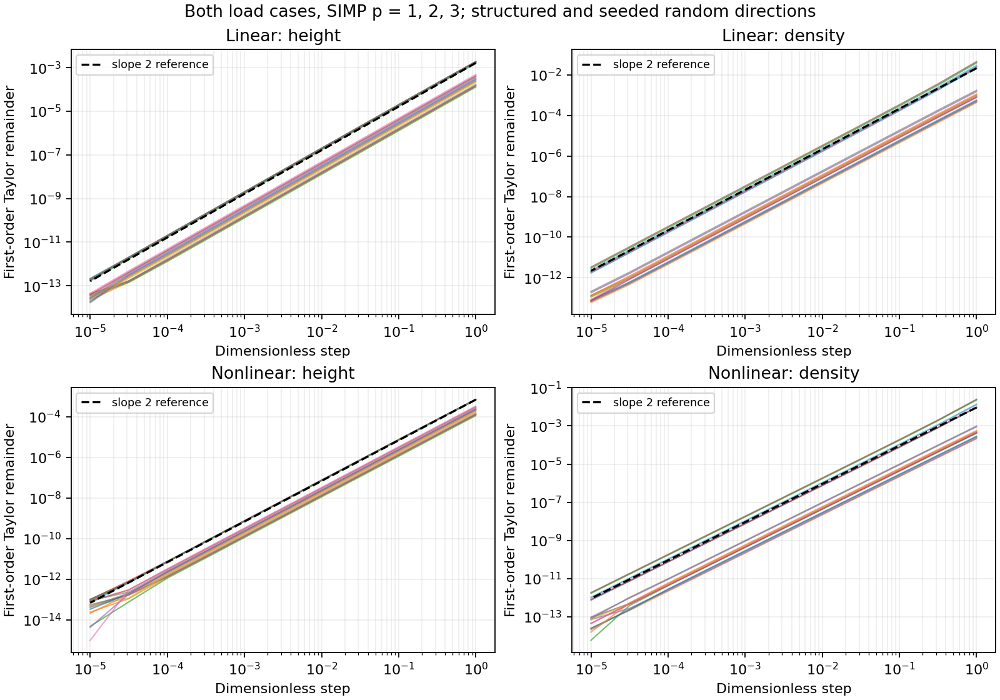

# Reproducing Agent 2 sensitivity evidence

From the repository root, install `Project4/requirements-project4.txt`, then run:

```powershell
.\.venv\Scripts\python.exe -m Project4.heatsink.run_all --check-gates
.\.venv\Scripts\python.exe -m Project4.heatsink.verification --config Project4/config.yaml
.\.venv\Scripts\python.exe -m pytest Project4/tests/test_sensitivity.py -q
.\.venv\Scripts\python.exe -m pytest Project4/tests -q
```

The standalone verification command validates the existing human gate. It never
calculates or changes student benchmark truth and does not run optimization.
It writes `sensitivity.json`, `sensitivity.md`, and `taylor_checks.png` here.
Numerical data and plots are generated, not transcribed manually. Python/package
versions, source commit, source hashes, design, directions, and random seed are
recorded in JSON. Wall times depend on the machine and load.

## What is checked

- Nominal and overload constraints, with linear and nonlinear physics.
- SIMP penalties 1, 2, and 3, using nonuniform heights of 25--40 mm and raw
  densities of 0.45--0.65. This avoids reflection symmetry masking errors and
  exercises propagation through the density filter.
- Each height/density family has one structured and two seeded random directions:
  72 constraint sweeps in total, each with 11 dimensionless steps from 1 to 1e-5.
- Each central difference uses converged state solves only, independently of the
  adjoint routine. Perturbations stay within the configured bounds.
- Taylor slope is fitted on the first four (largest) steps, fixed before inspecting
  results. Acceptance remains 1.8--2.2, and the best relative directional error
  must be at most 1e-5. All smaller-step results remain visible: cancellation,
  solver error, and roundoff eventually dominate the remainder.
- All 40 gradient entries are compared with central differences separately for
  both loads and both physics modes at p=3. Relative errors are also reported
  separately by family so height units cannot hide density errors.
- The mass objective has structured and random direct-gradient checks for both
  families. It is affine in either family separately, so its first-order Taylor
  remainder in those directions is roundoff, not an expected slope-two curve.
- KS is checked against finite differences for every state DOF, including tied
  temperatures, nonuniform states, and a large temperature offset. Checks include
  off-chip zero support, gradient sum one, equal tie weights, and translation
  invariance. The large-offset state is a numerical stability test, not a physical
  temperature scenario.



## Derivatives being verified

For each load case, the assembled equilibrium is `R(T,x)=0`. Differentiating gives
`R_T T_x + R_x = 0`. For `g = KS(T)/T_limit - 1`, there is no explicit design term
at fixed state. With the convention in `model.py`, solve

```text
R_T^T lambda = -g_T^T
dg/dx = lambda^T R_x
```

The same expression applies to linear and nonlinear physics, with `R_T` evaluated
at the converged state. The nonlinear tangent includes both convection and
radiation derivatives. `R_x` includes fin length, SIMP conduction, density-scaled
side/tip loss, and the filter chain rule from filtered to raw density.

For `KS = Tmax + log(sum(exp(beta*(Tj-Tmax))))/beta`,
`dKS/dTj = exp(beta*(Tj-Tmax))/sum(exp(beta*(Tk-Tmax)))` on chip nodes and zero
elsewhere. Dividing by `T_limit` gives the constraint state derivative.

For mass `m = rho_Al*(Vbase + d*t*sum(H_i*(F*r)_i))`,
`dm/dH = rho_Al*d*t*(F*r)` and `dm/dr = rho_Al*d*t*F^T*H`.
There is no state dependence and hence no nonzero mass adjoint to solve.

## Timing and scope

Each full-gradient comparison measures one warmed state-plus-adjoint evaluation
against 80 state-only evaluations for central differences. Finite differences
perform **zero adjoint solves**. The previous implementation unnecessarily called
the adjoint routine for every perturbation; this inflated the timing denominator.
The regression test counts these calls. Report measured speedups as observations,
not performance guarantees.

These checks establish local numerical consistency of the implemented smooth
model, not physical accuracy, final optimization feasibility, or correctness of
binary thresholding. They cover an interior design; the floor/threshold limit
requires separate topology validation. The course brief asks for every constraint
and variable family; the Agent 2 prompt additionally calls for relevant linear
and nonlinear states, so both are included.

Existing `run_all.py` calls remain compatible and generate their original nonlinear
V7 subset with the improved random directions and corrected cost comparison.
The standalone command is required to regenerate the complete 72-sweep evidence,
KS tests, and plot. Agent 5 owns wiring that expanded suite into the full campaign;
running the current full campaign may overwrite the JSON/Markdown with its subset.
