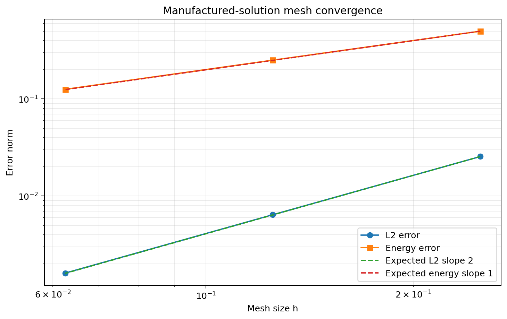
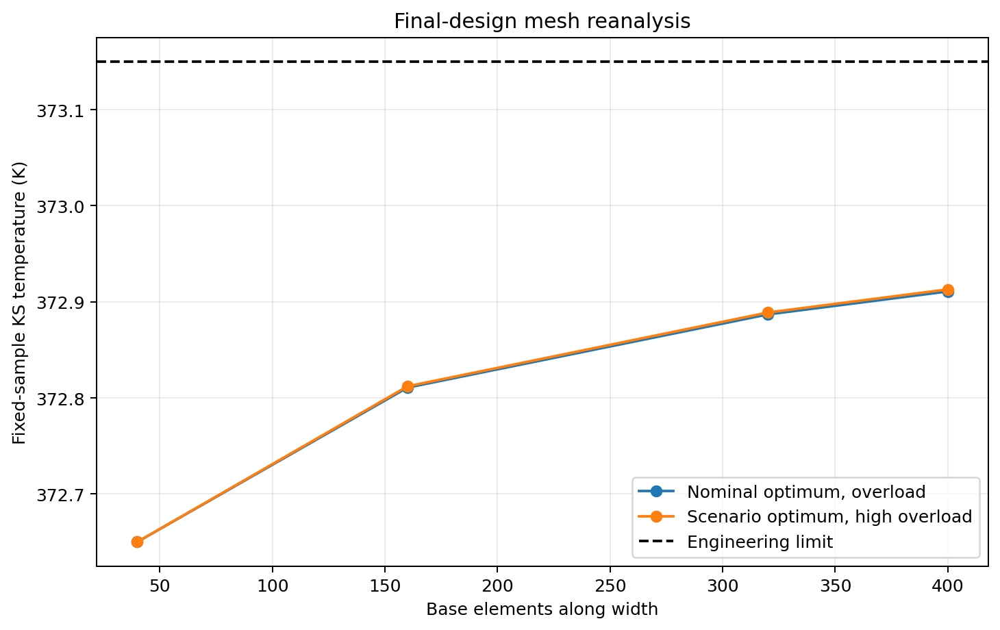

# PDE-Constrained Heat-Sink Optimization

**Team Optimus Prime:** Charles Green, Christian Miranda, Kellen Worthington, Lucas Somoshegyi-Szokol, and Polina Kondratiuk

<div class="gate"><strong>Data status:</strong> <span id="data-status">loading</span>. Numerical results are loaded from <code>assets/results.json</code>.</div>

## Summary and live 3D comparison

Power electronics need a path for waste heat to leave the chip; excessive temperature can reduce reliability or require power to be limited. We study a lightweight, passively cooled 6061-T6 aluminum heat sink under normal and hotter, higher-power conditions. The starting design is lighter but fails the thermal requirements, so it is not a feasible baseline for claiming a mass saving.

The initial and optimized designs share one camera and are drawn at true scale without fin thickening. Colors show the nominal-case temperature field, interpolated using the Q4 base-element and linear fin-element shape functions. Dark outlines identify parts with at least one node above the nominal temperature limit. During history playback, geometry changes while colors remain fixed to the final-state field because temperatures were not saved at every iteration.

<div class="controls"><button id="play-history">Play/pause optimization history</button><span>Nominal temperature (K)</span><span id="color-low"></span><div class="colorbar" style="width:160px"></div><span id="color-high"></span></div>
<div id="viewer"><div class="viewer-labels"><strong>Initial</strong><strong>Optimized</strong></div><div id="tooltip"></div></div>
<div id="metrics" class="metrics"></div>
<script type="module" src="assets/viewer.js"></script>

## Structure and formulation

<span id="formulation-geometry">Loading design geometry and variable bounds.</span> The primary variables are fin heights $H_i$ and raw topology densities $\rho_i$, which are filtered before use. The objective is

$$m=\rho_{Al}\left(V_b+d t_f\sum_i \bar\rho_iH_i\right).$$

<span id="formulation-loads">Loading load cases and constraints.</span> A bounding analysis showed that the original power-load specification was infeasible even at maximum material, prompting the team to revise the study cases.

For load case $s$, the optimizer imposes the buffered constraint:

$$
g_s = \frac{\mathrm{KS}_{\beta}(T_{\mathrm{chip},s}) + r}{T_{\mathrm{limit},s}} - 1 \leq 0
$$

where $r$ is the numerical refinement reserve, and the KS aggregation function is defined as:

$$
\mathrm{KS}_{\beta}(T) = T_{\max} + \frac{1}{\beta}\ln\left(\sum_j \exp\left[\beta(T_j - T_{\max})\right]\right)
$$

<span id="sampling-reserve">Loading the fixed sampling and numerical reserve.</span> The temperature limits are illustrative project-level engineering targets rather than values from a specific chip datasheet. The higher overload target permits a warmer steady-state case at higher power and ambient temperature; it is not a transient rating. The KS aggregate spans the full chip footprint, with finite-element interpolation at fixed physical locations; it is an upper bound on the sampled values. The actual peak over the piecewise-linear chip interface is also checked separately. Keeping the sample positions fixed prevents the number of mesh nodes from changing the aggregate. The mass expression counts a fixed base plus filtered fin volumes; constants, bounds, mesh and loads are recorded in the repository's configuration.

## Analysis model

The custom solver uses bilinear quadrilateral conduction elements in the base and coupled linear one-dimensional fin elements. The extruded depth is included in conduction, mass, heat input, and surface loss. The nonlinear boundary heat flux and its regularized convection coefficient are

$$q_s=h(T)(T-T_\infty)+\epsilon\sigma(T^4-T_\infty^4),\qquad h(T)=h_{ref}\left(\frac{\sqrt{(T-T_\infty)^2+\delta^2}}{\Delta T_{ref}}\right)^{1/4}.$$

<div id="model-parameters">Loading material and boundary parameters.</div>

The quarter-power law is a simplified modeling assumption, not a full Churchill–Chu calculation. The reference coefficient, black-anodized emissivity, and engineering temperature limits are assumptions; no particular finish or chip has been validated against a datasheet.

Newton's method uses the consistent analytic tangent and backtracking. <span id="dof-count">Loading model size.</span> Assumptions include temperature-independent thermal conductivity, no contact resistance, an adiabatic underside outside the chip, and a reduced-order 1D representation of each plate fin.

The base solves $-\nabla\cdot(k\nabla T)=0$ in its cross-section. A prescribed heat flux is integrated over the exact centered chip footprint, including partial boundary elements; the remainder of the underside and the base side edges are insulated. The global conduction and tangent matrices are sparse. The full base top receives surface loss, including the area represented by fin roots: fins connect to nodes rather than replacing a finite-width base patch. Each fin carries axial conduction and loses heat from its sides and tip. This full-top exposure, point-like fin-root coupling, and the lack of resolved air flow or mutual fin shielding can affect mesh behavior and overestimate cooling; extrapolating to a manufactured design requires external validation.

## Verification

The team independently derived benchmark values before using the coding agent to evaluate the solver. The ladder covers exact conduction and fin solutions, mesh convergence, energy balance, reflection and unit invariance, a nonlinear benchmark, and gradient checks.

<div id="verification-summary" class="data-panel">Verification data is loading from the generated results.</div>

The manufactured-solution mesh study compares the measured error slopes with the expected Q4 rates:



The independently derived scalar Newton benchmark above is supplemented by a prescribed-root nonlinear fin cross-check: the production finite-element residual and tangent are compared with an independently formulated SciPy boundary-value solution on two meshes. Residual ratios $\|R_{n+1}\|/\|R_n\|^2$ show local quadratic convergence before roundoff; the consistent tangent is also checked against a central directional difference. This is a numerical reference, not an independently derived exact solution or validation of real-world convection.

<div id="fin-check-summary">Loading nonlinear fin cross-check.</div>

The final nominal and uncertainty designs are also held fixed and reanalysed on progressively finer base meshes. The fixed physical chip-sampling positions and original engineering limits are used on every mesh. The final two mesh levels must differ by less than the stated verification tolerance, and every case must remain feasible.

<div id="design-mesh-summary">Loading design mesh study.</div>



## Sensitivities

For residual $R(T,x)=0$ and response $f(T,x)$, each discrete adjoint solves

$$R_T^T\lambda=-f_T^T,\qquad \frac{df}{dx}=f_x+\lambda^TR_x.$$

This follows by differentiating $R(T(x),x)=0$: $R_TT_x+R_x=0$. Multiplying by $\lambda^T$ eliminates $T_x$ from the total derivative. For each scaled temperature constraint, $f_T$ is the KS softmax weight vector mapped back to FE nodes through the transpose of the fixed-point interpolation matrix and divided by the temperature limit; $f_x=0$ at fixed state. The fixed numerical reserve has zero design derivative. Mass is independent of the thermal state, so its gradient is computed directly. The same adjoint relation applies to the converged nonlinear tangent.

The implementation includes analytic $R_x$ for every height and raw density, including density-filter propagation, SIMP conduction, changing fin length, and density-scaled surface loss. The table compares adjoint and central-difference directions for both load cases and both variable families.

<div id="sensitivity-summary"></div>

<canvas id="taylor-plot" class="report-plot" width="900" height="360" aria-label="Taylor-test error plot"></canvas>

## Optimization

The staged campaign uses SLSQP for the linear fixed-topology, nonlinear fixed-topology, and SIMP-continuation studies, followed by a `trust-constr` KKT-polishing stage. The mass objective is divided by the starting mass; SLSQP uses physical design-variable units, while the KKT polish maps each bounded height to the unit interval. The overload constraint at the buffered target governs the reported nonlinear solution. Every iteration stores the design, mass, and constraint values for the animation. The reserve is an engineering numerical margin, not a proof of convergence at infinite mesh resolution.

### Active constraint and multipliers

<div id="kkt-summary"></div>

<canvas id="history-plot" class="report-plot" width="900" height="360" aria-label="Optimization convergence plot"></canvas>

The history concatenates separate optimizer stages; dashed vertical lines mark stage changes, so jumps between stages are not individual-iteration convergence failures.

## Nonlinear component — bonus +5

The N2 state includes temperature-dependent natural convection and $T^4$ radiation, is solved by Newton's method, differentiated at the converged state, and checked against the independently solved nonlinear benchmark. The linear and nonlinear fixed-topology optima are listed in the results table. <span id="linear-reference">Loading the linear reference coefficient.</span> The difference reflects both the boundary-law change and the chosen reference coefficient; it should not be interpreted as an isolated radiation effect.

<div id="comparison-summary"></div>

## Ground-structure topology study

Candidate fins may vanish through filtered density variables. A density floor prevents singular conduction matrices, SIMP continuation discourages gray fins, and a one-dimensional filter suppresses alternating artifacts. Filtering makes an isolated thresholded raw density differ from the physical density, so mixed topologies need further validation before they can be treated as removed fins.

At $p=1$ the three topology starts use the fixed-topology solution, uniform raw density 0.60, and an edge-weighted density profile. Feasible starts compete on mass; the selected design then proceeds through $p=2$ and $p=3$, thresholding, and height re-optimization. The selected result retains all 20 fins. The screened low-density candidate is filtered, so it does not establish a feasible physically removed fin; we do not claim the topology bonus on that basis.

<div id="topology-starts"></div>

## Design under uncertainty — bonus +5

The scenario study perturbs each load case to paired low and high power and ambient conditions. These are illustrative bounded scenarios, not a measured probability distribution or a reliability guarantee. Each scenario is constrained separately and its adjoint gradient is checked against central differences.

<div id="uncertainty-summary">Uncertainty results are loading from the generated data.</div>

## Results

The table compares mass and both temperature constraints. The physical peak and the smooth KS aggregate are shown separately: KS bounds the temperatures at the fixed sample points, but it is not necessarily an upper bound between those points. The full piecewise-linear chip peak is checked separately. PASS uses the KS value and allows the configured scaled feasibility tolerance of $10^{-4}$.

<div id="results-table"></div>

Presentation figures generated from the same results: [mass comparison](assets/figures/mass-comparison.png), [Taylor checks](assets/figures/taylor-checks.png), and [uncertainty comparison](assets/figures/uncertainty-comparison.png).

## Reproducibility

From a clean repository clone, install `Project4/requirements-project4.txt`, then run the command below from the repository root. The completed approval and student-authored benchmark inputs are already tracked in the repository; the command validates them before running.

```text
python -m Project4.heatsink.run_all --config Project4/config.yaml
```

## Limitations and AI-use statement

The solver, adjoint, optimizer interface, serialization, and viewer were drafted with a coding agent. The students independently supplied the benchmark truth and checked the benchmark derivations; the team reviewed the work. Verification exposed an implementation bug in the original cost comparison: each finite-difference perturbation unnecessarily computed an adjoint, inflating the reported finite-difference cost. The corrected comparison uses state-only solves and a regression test checks this. A separate feasibility bound showed that the initial 100/125 W cases were infeasible, so the team approved 50/60 W study cases. Reduced-order fins and empirical natural convection limit predictive fidelity; the results are a design study, not certification data.

## References

1. [Hydro, “Alloy 6061” data sheet](https://www.hydro.com/globalassets/01-products--services/extruded-profiles/americas/ena-resources/alloy-data-sheets/hydro_2019_data_sheet_6061.pdf), thermal conductivity and density.
2. [NIST, Fundamental Physical Constants](https://physics.nist.gov/cuu/Constants/), Stefan–Boltzmann constant.
3. [Sandia SIERRA/Aria documentation](https://www.sandia.gov/files/sierra/Aria_Users_5_24/simulation_setup/advanced_feat/correlation_heat_transfer_coeff_reference.html), Churchill–Chu natural-convection correlation.
4. Course [Project 4 brief](https://designinformaticslab.github.io/DesignOptimization2025/project4.html).
